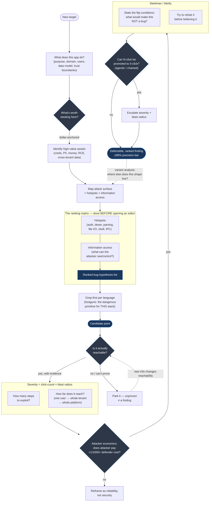
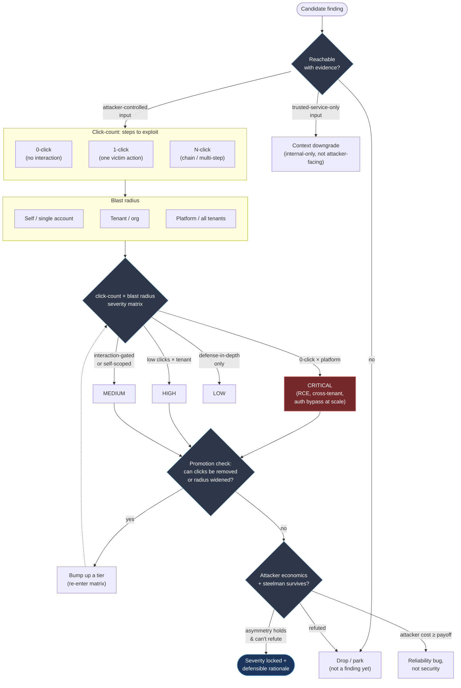

# How Kurt thinks about security bugs — a model

A reflective synthesis of Kurt Boberg's documented bug-hunting doctrine, drawn from
`bug_hunting_first_principles_expertise.md`, `code_review_expertise.md`, the
severity/triage/reachability specs, and the steelman discipline that runs across all of it.

Two views:

1. **The hunt** — how a candidate becomes a defensible finding.
2. **Triage / severity** — how a finding's weight is decided.

---

## 1. The hunt

### What's most distinctively Kurt here

- **Rank before you read.** The hotspot × information-access matrix produces a hypothesis
  list *before* the editor opens — the center of gravity is upstream of any code.
- **Reachability is a hard gate, not a footnote.** Unproven reachability parks the finding
  rather than silently downgrading it.
- **Severity is mechanical** — click-count × blast radius — not eyeballed. The
  **N-click → 0-click promotion test** is first-class (Clinejection / CurXecute shape).
- **Attacker economics is a filter, not flavor text** — the <1/1000× asymmetry threshold
  decides whether something is a *security* bug or a *reliability* bug.
- **Steelman runs as refutation**, with explicit flip-conditions, before belief.
- The dashed loops — **variant analysis** and **reachability re-entry** — make it a hunt,
  not a checklist.

---

## 2. Triage / severity — how a finding's weight is decided

### The triage thesis

Severity isn't a vibe — it's the **product of two measurable axes** (click-count ×
blast radius), passed through a **promotion check** (can you remove clicks or widen
radius?) and two **honesty gates** (attacker-economics asymmetry and steelman
survival). A finding only locks its severity once it has survived refutation and the
economics actually favor the attacker. Everything else is reframed (reliability),
context-downgraded (trusted-service-only), or dropped.

---

*Anchors: `bug_hunting_first_principles_expertise.md` (hotspot × info-access matrix,
DoS asymmetry threshold, agentic N-click → 0-click promotion, per-language grep-first),
`code_review_expertise.md` (click-count severity, auth-homogeneity), `SEVERITY_DEFINITION.md`
(blast-radius tiers), `FINDING_ACTIONABILITY_TRIAGE.md` (reachability/context/trusted-service),
`REACHABILITY_VERIFICATION.md` (evidence bar), `steelman_doctrine_expertise.md`
(flip-conditions, refutation-first).*
